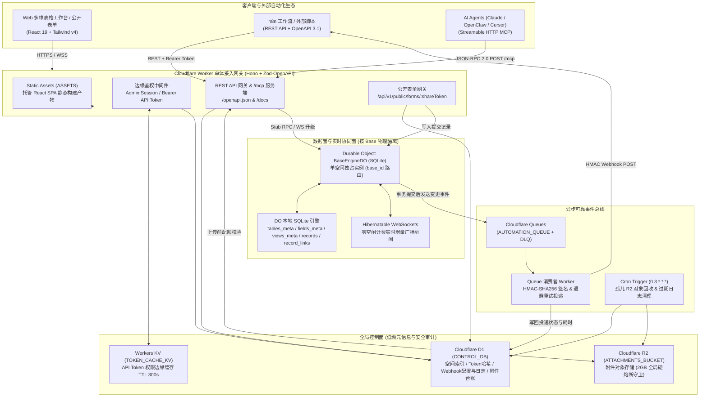
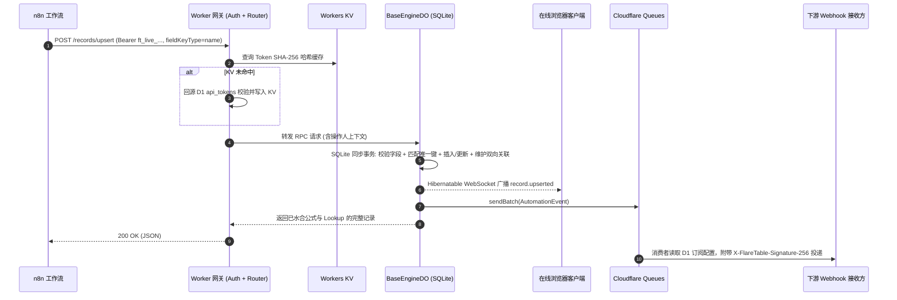

# 02. 系统架构设计 — Cloudflare Workers Paid 原生全栈架构

## 1. 总体架构思想：控制面与数据/协同面物理分离

FlareTable 放弃了“将全部租户和海量单元格塞进单一集中式数据库”的传统做法，而是最大化发挥 **Cloudflare Workers Paid (\$5/月)** 提供的高级有状态能力，采用**“轻量级全局控制面 + Per-Base SQLite Durable Object 数据与协同面”**的架构：

---

## 2. 为什么选择 “Per-Base SQLite Durable Object”？

1. **零网络延迟的数据计算引擎**：
   在多维表格场景中，一次记录写入可能伴随类型校验、字段名到 `fld_xxx` 的映射、双向关联 `record_links` 同步以及后续的 `lookup` 与 `formula` 计算。在传统 Worker + 外部 DB 架构下需要多次跨区网络 RTT；而在 `BaseEngineDO` 内，Worker 代码与 SQLite 存储运行在**同一个边缘隔离实例与同一磁盘块**上，所有读写均通过同步事务（`storage.transactionSync`）原子完成，毫秒级返回。
2. **天然的租户级物理隔离与并发串行化**：
   每个 Base 对应唯一的 Durable Object ID（`idFromName(baseId)`），不同空间互不干扰、无锁争抢；同一空间内的并发写入与行级顺序 `rank` 分配天然由 DO 单线程事件循环序列化保障，绝不会出现脏读或版本号错乱。
3. **协同与数据同体（Hibernatable WebSocket）**：
   前端直接连入对应空间的 `BaseEngineDO` WebSocket 房间。使用 `this.ctx.acceptWebSocket(server)` 后，即使有数十个浏览器标签页长连挂机等待自动化通知，连接休眠期间**不产生 Durable Object 活跃计费时长**；一旦 n8n 或 Agent 写入一条新纪录，DO 在当前事务提交后即刻唤醒并广播增量事件给在线前端。

---

## 3. 核心请求与事件时序图

### 3.1 n8n 幂等写入 → 前端实时刷新 → 异步触发下游 Webhook

---

## 4. 模块化代码分层设计

为保证高度可解释性、可测试性与未来扩展性，后端代码严格分为四层，禁止跨层耦合：

1. **共享契约层 (`packages/shared`)**：
   - 纯 TypeScript + Zod 定义，零平台绑定依赖。
   - 定义 ID 生成规范（语义前缀如 `base_`、`tbl_`、`fld_`、`rec_`）、13 种字段配置 Schema、筛选/排序 AST、视图契约、实时事件负载与 OpenAPI DTO。
2. **纯净表格领域引擎 (`apps/worker/src/base-engine/`)**：
   - 通过极简同步驱动接口 `SyncSqlDriver` 与 Cloudflare 运行时解耦。
   - 生产环境注入包装了 `ctx.storage.sql` 的 `DoSqlDriver`；单元测试则直接注入基于 Node v24 原生 `node:sqlite` 的 `NodeSqlDriver`。
   - 这使得全部公式解析、筛选 SQL 编译、双向关联和 `upsert` 核心算法可以在 Vitest 中毫秒级全覆盖验证，无需依赖脆弱的外部模拟。
3. **Cloudflare 控制面服务 (`apps/worker/src/control-plane/`)**：
   - 封装对 D1、KV、R2 的所有访问，包括幂等建表引导（`bootstrap.ts`）、API Token 生命周期管理、HMAC Webhook 投递器及 R2 2GB 硬熔断守卫。
4. **多协议接入层 (`routes/`, `mcp/`, `queue/`, `durable-objects/`)**：
   - REST/OpenAPI 路由仅做参数验证与权限拦截；
   - MCP Server 复用了同一套 `BaseEngineDO` RPC 与 `control-plane` 服务，保证通过 REST、UI 与 AI Agent 看到的 Schema、公式计算结果与触发的事件流 100% 一致。
