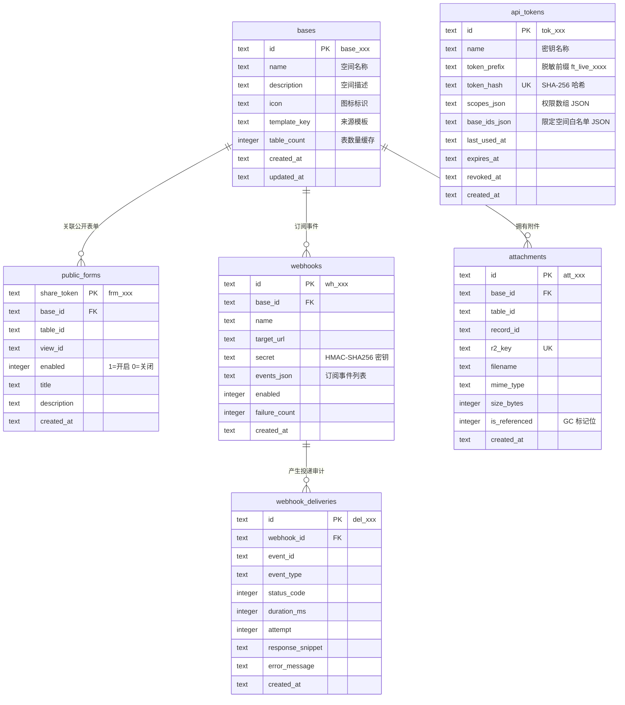
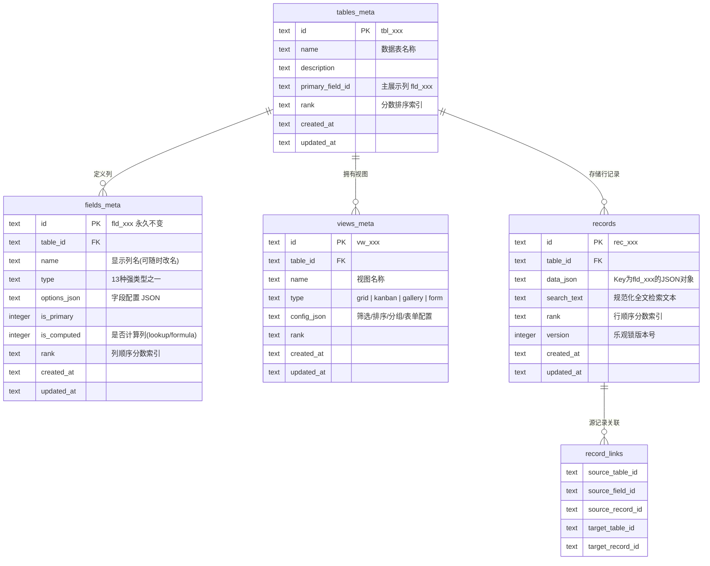

# 03. 数据库设计 — D1 全局控制面与 DO SQLite 数据面

FlareTable 采用“全局控制面（D1）+ 单空间数据面（DO SQLite）”的双库模型，兼顾全球统一鉴权/审计查询与单空间强事务零延迟体验。

---

## 1. 控制面 ER 关系图 (Cloudflare D1: `CONTROL_DB`)



### 1.1 控制面 DDL (`apps/worker/migrations/0001_control_plane.sql`)

- **`api_tokens` 安全性**：平台永远不存储明文 Token，仅在创建接口响应瞬间返回一次完整密钥，持久化仅保留 `token_hash`（SHA-256 Hex）与用于界面辨识的 `token_prefix`（如 `ft_live_9a2f...`）。
- **`attachments` 配额台账**：所有通过 Worker 上传到 R2 的附件必须先通过 `SELECT COALESCE(SUM(size_bytes), 0) FROM attachments` 核验全局累计字节数，确保绝对不超过设定的安全熔断阈值（默认 2 GB）。

---

## 2. 数据面 ER 关系图 (Per-Base DO SQLite)

每个多维表格空间内部运行完全自洽的 5 张核心关系表：



---

## 3. 核心存储机制解析

### 3.1 为什么 `records.data_json` 使用不可变 `fld_xxx` 作为键？
多维表格最常见的操作是**重命名列**（例如将“客户名称”改为“公司全称”）。如果使用列名作为 JSON 键，重命名列就必须扫描并重写全表几万行 JSON。
FlareTable 采用以下策略：
- 内部存储永远以全局唯一且不变的 `fld_xxx` 作为键（`{"fld_a1b2": "字节跳动", "fld_c3d4": 98000}`）。
- 修改列名只需 `UPDATE fields_meta SET name = ? WHERE id = ?`，零行记录重写。
- 面向人类和 n8n 的外部 API 请求通过 `fieldKeyType=name` 参数，在内存入口处将字段名透明双向映射为 `fld_xxx`。

### 3.2 动态 SQLite `json_extract` 表达式索引
为了兼顾 Schema-less 的动态加列能力与关系型数据库的毫秒级筛选排序速度，每当用户创建或初始化非计算字段（`text`、`number`、`single_select`、`date`、`checkbox`、`email`、`url`）时，引擎自动在当前空间 SQLite 上下发表达式索引：

```sql
CREATE INDEX IF NOT EXISTS idx_records_fld_xxx
ON records (table_id, json_extract(data_json, '$.fld_xxx'));
```

随后 `query-compiler.ts` 将前端或 n8n 传入的 `FilterGroup` 条件树与 `SortSpec` 编译为全参数化的 `json_extract(data_json, '$.fld_xxx')` SQL 条件（绝无字符串拼接注入风险），直接命中 SQLite B-Tree 索引。

### 3.3 规范化 `record_links` 边表与对称双向关联
将关联关系除了缓存 ID 数组外，额外规范化存储在 `record_links` 边表中（联合主键 `(source_field_id, source_record_id, target_record_id)`，并建立反向索引 `idx_links_target(target_record_id)`）：
- 当 A 表记录更新关联指向 B 表记录时，若该关联字段配置了 `symmetricFieldId`，事务内自动同步维护 B 表对应记录的关联数组与双向边。
- 当目标记录被删除时，可精准快速级联清理所有引用它的关联边，彻底杜绝悬挂引用（Dangling Links）。
- 计算 `lookup` 字段时，通过批量 `IN (...)` 一次性加载目标记录并按字段类型提取聚合，消除 N+1 查询问题。

### 3.4 分数索引 (`fractional-rank.ts`)
所有表、列、视图与行记录的顺序均采用基于字典序字符的分数索引（例如 `"a0"`, `"a1"`, `"a0V"`）。在任意两行之间插入新行，或拖拽重排单行时，只需生成介于前后两项 `rank` 之间的新字符串，单行 `UPDATE` 即可完成重排，时间复杂度为 $O(1)$。
